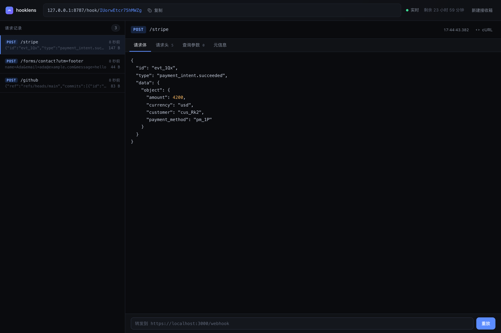
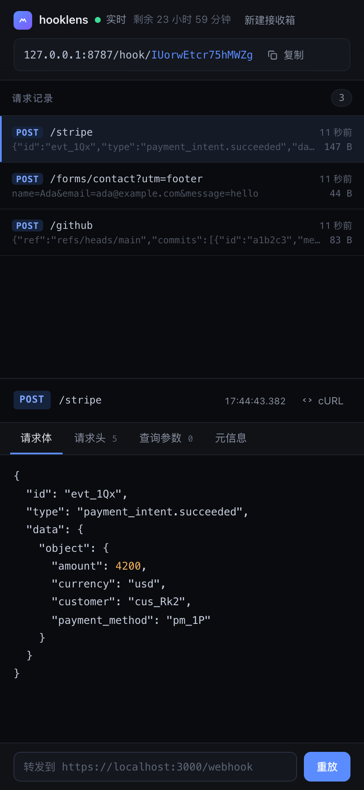

# hooklens

一个自托管的 webhook 调试器：生成一个一次性 URL，任何打到这个 URL 的请求都会被完整捕获，并在浏览器里实时呈现。

```
POST /hook/8fK2pQ → 浏览器里立刻出现 method、headers、query、raw body
```



<details>
<summary>移动端</summary>



</details>

**单文件 Go 二进制 + Redis**，无前端构建步骤。数据全部放在 Redis 里，靠原生 TTL 自动过期，所以：

- 进程重启、重新部署，接收箱和已捕获的请求都还在；
- 可以横向起多个实例，任意一个实例收到请求，**所有实例**上的浏览器都能实时看到（Redis Pub/Sub 广播）。

## 为什么是它

它是上一轮讨论里的「引流探针」：一个免费、无需登录、立刻能用的调试器，用来收集"谁在真实地调试 webhook"这批人，然后向他们卖自动重试 / 告警 / 团队协作。

所以它的设计目标不是功能齐全，而是**打开就能用、不需要解释**。

## 功能

- **免注册开箱**：点一下拿一个 `/hook/<token>` 地址，24 小时后自动消失
- **任意方法、任意路径**：`POST /hook/<token>/stripe/evt_1?x=1` 也能拦，path 和 query 单独拆开展示
- **实时推送**：SSE 推流，新请求秒级出现，不用刷新；跨实例也生效
- **字节级保真**：原始 body 保留到 1 MiB，二进制自动 base64
- **JSON 美化**：content 是 JSON 时自动格式化并高亮
- **一键回放**：把捕获到的原始请求（方法、头、body）转发到你的本地或 staging 地址
- **Copy as cURL**：把任意一条请求渲染成可粘贴的 curl 命令
- **SSRF 防护**：回放默认拒绝连接回环、私有、链路本地、组播地址

## 跑起来

最省事的方式（需要 Docker）：

```bash
docker compose up --build
```

打开 http://127.0.0.1:8787 ，点「创建接收箱」，然后：

```bash
curl -X POST http://127.0.0.1:8787/hook/<token>/orders \
  -H 'Content-Type: application/json' \
  -H 'X-Signature: t=1,v1=abc' \
  -d '{"event":"payment.succeeded","amount":4200}'
```

没有 Docker、只有 Podman 时，先起一个 Redis 容器（macOS 需要先启动 machine）：

```bash
podman machine start podman-machine-default      # 首次，或已停止时
podman run -d --name hooklens-redis -p 6379:6379 \
  --health-cmd "redis-cli ping" --health-interval 3s --health-retries 10 \
  docker.io/library/redis:7-alpine \
  redis-server --maxmemory 256mb --maxmemory-policy volatile-ttl \
               --save "" --appendonly no

podman exec hooklens-redis redis-cli ping       # 应返回 PONG
```

然后接上去：

```bash
go run . -addr 127.0.0.1:8787 -redis 127.0.0.1:6379 -allow-private
```

想验证多实例，再加一个进程指向同一个 Redis：

```bash
go run . -addr 127.0.0.1:8788 -redis 127.0.0.1:6379 -allow-private
```

A 上捕获的请求会实时出现在 B 的浏览器里，两个实例读到的历史数据也完全一致。

`-allow-private` 只在本地开发时需要：它允许「回放」打到 `localhost`。**线上部署不要加**，否则回放接口就是一个能访问内网和云元数据地址的开放代理。

只是想临时看一眼、不想起 Redis：

```bash
go run . -storage=memory
```

`-storage=memory` 是开发逃生口，重启即丢数据，且 SSE 只在本进程内生效；**生产默认走 Redis**。

### 参数

| 参数 | 默认值 | 说明 |
| --- | --- | --- |
| `-addr` | `:8787` | 监听地址 |
| `-ttl` | `24h` | 接收箱存活时间 |
| `-storage` | `redis` | `redis` 或 `memory` |
| `-redis` | `127.0.0.1:6379` | Redis 地址，也支持 `redis://` / `rediss://` URL |
| `-redis-password` | 空 | Redis 密码 |
| `-redis-db` | `0` | Redis 数据库编号 |
| `-allow-private` | `false` | 允许回放到私有地址（仅本地开发） |

### 环境变量

优先级：`-redis` / `-redis-password` 命令行参数 > 环境变量 > 内置默认值。PaaS 上直接注入即可，不用改启动命令。

| 变量 | 说明 |
| --- | --- |
| `REDIS_URL` | 完整 URL，如 `rediss://:pass@host:6380/0`；优先级高于 `REDIS_ADDR` |
| `REDIS_ADDR` | `host:port` |
| `REDIS_PASSWORD` | 密码 |

启动时会先 `PING` 再订阅频道，连不上 Redis 会直接退出并打印明确错误，不会静默退化成内存存储。

### 测试

```bash
go test -race ./...
```

测试用 `miniredis`（纯 Go，不需要真的装 Redis），并且**同一套用例分别跑在 Redis 和内存两个后端上**，保证行为一致。覆盖：捕获保真、二进制 body、body 截断、请求上限淘汰与 payload 清理、TTL 过期、SSE 推流、跨实例 Pub/Sub、回放转发、回放拦截私有地址、创建限流、Redis key 的 TTL。

`miniredis` 只是模拟器，Lua 脚本 / `PEXPIREAT` / `PSUBSCRIBE` 还应该在真实 Redis 上验一遍。有 Redis 时加一个环境变量即可（测试固定使用 **DB 15** 并会 `FLUSHDB`，不会碰到其他数据）：

```bash
HOOKLENS_REDIS_TEST_ADDR=127.0.0.1:6379 go test -race -count=1 ./...
# 只跑真实 Redis 用例：
HOOKLENS_REDIS_TEST_ADDR=127.0.0.1:6379 go test -race -run TestRealRedisIntegration -v
```

未设置该变量时集成测试会跳过，CI 里不需要额外准备 Redis。

## Redis 键设计

| Key | 类型 | 内容 |
| --- | --- | --- |
| `hooklens:bin:{token}` | HASH | token、createdAt、expiresAt、dropped 计数 |
| `hooklens:bin:{token}:ids` | LIST | 请求 ID，新的在左；`LTRIM` 到上限 |
| `hooklens:bin:{token}:data` | HASH | `id → 请求 JSON`；文本直存，二进制 base64 |
| `hooklens:bins` | ZSET | `token → expiresAt(ms)`，用于全局数量和上限 |
| `hooklens:events:{token}` | Pub/Sub 频道 | 新请求的**摘要**（不含 body） |

几个关键决定：

- **过期完全交给 Redis**：三个 bin key 都设 `PEXPIREAT expiresAt`，到期自动消失，没有后台扫表，也没有"忙的 bin 永不过期"的偏差。`GC()` 只清理全局 ZSET 里的陈旧成员。
- **写入用 Lua 保证原子**：一次 `EVAL` 完成 `LPUSH` + `HSET` + 超出上限时淘汰并 `HDEL` 被淘汰的 payload + 累加 dropped + 刷新 TTL。否则并发写入会留下对不上的 ids 和 data。
- **Pub/Sub 只广播摘要**：body 最大 1 MiB，不能因为来了一条请求就把它推给所有实例。SSE 客户端拿到摘要先渲染列表，点开再按 ID 拉详情。
- **一个连接订阅所有 bin**：`PSUBSCRIBE hooklens:events:*`，收到消息后按 token 扇出给本进程的 SSE 订阅者。避免每个打开的页面一条 Redis 连接。
- **被淘汰的 payload 会真的删掉**：只 `LTRIM` 会留下孤儿 hash 字段一直占内存到 TTL，所以 Lua 里顺手 `HDEL`。

## HTTP 接口

| 方法 | 路径 | 说明 |
| --- | --- | --- |
| `POST` | `/api/sessions` | 新建接收箱，返回 token / binUrl / expiresAt |
| `GET` | `/api/sessions/{token}` | 接收箱元信息 |
| `ANY` | `/hook/{token}[/...]` | 捕获端点，返回 `{"ok":true,"id":...}` |
| `GET` | `/api/sessions/{token}/requests` | 请求列表（不含 body） |
| `GET` | `/api/sessions/{token}/requests/{id}` | 单条详情（含 body） |
| `GET` | `/api/sessions/{token}/events` | SSE 事件流 |
| `POST` | `/api/sessions/{token}/replay?id={id}` | 回放，body 为 `{"targetUrl":"https://..."}` |
| `GET` | `/healthz` | 健康检查，含 `storage` 和 `bins` |

## 部署

`docker compose up --build` 会同时起 app 和 Redis（带 AOF 持久化卷）。Fly.io / Render 这类平台指到 Dockerfile，再注入 `REDIS_URL` 即可；**多个实例可以共享同一个 Redis**，SSE 会自动跨实例工作。

单独用镜像时记得传地址：

```bash
docker run -p 8080:8080 \
  -e REDIS_ADDR=host.docker.internal:6379 \
  hooklens
```

生产环境放在 Caddy 或 Nginx 后面：

```caddy
hooklens.example.com {
    reverse_proxy 127.0.0.1:8787
    encode gzip
}
```

反代要关闭对 SSE 的缓冲（本项目已经带 `X-Accel-Buffering: no`，Nginx 场景加 `proxy_buffering off;`），并把读超时放到 5 分钟以上。

### 上线前还差两件事

1. **边缘保护**：创建 bin 已按 IP 限流（10 次/小时），但捕获端点没有限速。公开前建议在反代层补一层 IP 级限速，否则会被用来刷 Redis 内存。另外给 Redis 设 `maxmemory` + `volatile-ttl`（compose 里已经配了）。
2. **域名和邮件**：调试器本身不需要账号体系，但如果要做「回放失败告警」这类付费功能，就需要一个发信通道。

## 用它验证选题二

这个工具的用途不只是"自己用"，它是选题二（webhook 中继）的获客入口。建议的顺序：

1. **先让它能公开访问**，域名短一点。`hooklens` 这个名字是占位的，换一个更短更好记的。
2. **只发一次**：界面目前是中文，优先发 V2EX「分享创造」、即刻、掘金；标题写清楚解决什么问题，不要写"我做了一个工具"。想上 r/webdev 或 Show HN，先把文案抽成字典做一份英文版。
3. **看三个数字**：24 小时内创建了多少 bin、其中有多少个收到了第 2 个请求、有多少人点了 Replay。第三个是最强信号——**点了 Replay 的人，正在真实地调试一个真实的 webhook**。
4. **在页面底部埋一个邮箱输入**："Want automatic retries and alerting when a delivery fails?" 愿意留邮箱的人，就是付费版的种子用户。

转化率低于 2% 就说明这个入口不够痛，换选题；高于 5% 就值得把「自动重试 + 告警」做出来，按 $19/月 卖。

## 结构

```
main.go           启动、参数、环境变量、优雅退出、GC 协程
store.go          共享类型 + Store 接口 + 请求 JSON 编解码
redisstore.go     Redis 实现：Lua 原子写入、原生 TTL、Pub/Sub 扇出
memstore.go       内存实现（开发逃生口，也是测试的行为基准）
server.go         路由、捕获、SSE、回放、SSRF 防护、限流
web/index.html    单页前端（内嵌进二进制，无构建步骤）
server_test.go    双后端端到端测试
redis_integration_test.go  真实 Redis 集成测试（可选，需环境变量）
```

`Store` 接口很窄（9 个方法），HTTP 层完全不知道背后是 Redis 还是内存。想换 PostgreSQL / SQLite 只需再实现一个 Store。

## 已知取舍

- **界面只有中文**：文案直接写在 HTML 里，没有 i18n 层。要出海需要先把静态文案和 JS 里的字符串抽成字典，再加语言切换，大约半天。
- **Pub/Sub 是 at-most-once**：进程在「写入 Redis」和「PUBLISH」之间崩溃，这条事件不会被推送；但数据已经落盘，浏览器重连时 `onopen` 会重新拉一次列表，所以最终一致。要做严格不丢，得换成 Redis Streams + 消费位点。
- **Redis 重启**：compose 里开了 AOF，但数据本质上是 24 小时的临时调试数据，丢了也可接受。真正要保的是「应用重新部署不丢」，这一点已经满足。
- **固定窗口限流**在边界会放过 2 倍流量。对"防刷 bin"够用，对计费不够用；多实例下这个限流是每进程独立的，要全局得放到 Redis 里。
- **回放的 SSRF 防护**是在拨号阶段校验解析后的 IP，能挡住 DNS rebinding；但它不防"公网 IP 上跑着一个能反代的代理"。真要对外卖，回放需要更严格的出口策略。
